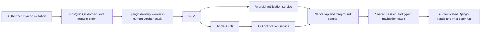

# SriSu notifications and Crashlytics plan

Proposal dated 2026-10-13. Feature implementation has not started. This is the first deliverable requested before agreeing on implementation. Firebase project: **srisu-ef431**. Keep Django on the current Docker deployment.

Use Firebase Cloud Messaging (FCM) for private alerts and native Firebase Crashlytics SDKs for Android and iOS. Keep authentication, authorization, plans, invitations, chat ciphertext and notification delivery records in the existing Django/PostgreSQL system. Preserve the current libsignal chat. Start with a small set of actionable alerts, generic lock-screen text, existing feature destinations, and no separate notification center.

## Project findings

### Repository baseline

| Source | Inspected state |
| --- | --- |
| Frontend SriZan12/SriSu | Local branch codex/consolidate-core-20261010, commit b0421d47691f741a92ded9b1db41531d5de89227. Existing untracked test__auth_flow_and_partner_linking_testing_.patch preserved. |
| Frontend integration branch | Live dev-new-theme ref: 3fa6822ea05578d64cca8891c5e3fdb0a831897a. It is distinct from the current working branch. |
| Local backend SrizanKhadka/SriSu | Branch codex/couple-chat-rebuild, commit 928318f00615cc4db15d68edce6ebde550cee9fb. Existing .DS_Store modification preserved. This checkout contains the older Matrix implementation. |
| Backend integration branch | Live dev ref: ecc8592307114e7d154bda9612e6826e2ca8ba90. It is distinct from both the local feature branch and the newer architecture branch. |
| Backend matching the current frontend | Live dev-core-architecture ref: 2c4f312b3cb0327d7d298615028370514db2feb7. Its code was read through GitHub; it contains the libsignal-compatible couple_chat API. This is the proposed backend implementation baseline. |
| Figma | File LztysD1YvINX7RwZpnhhTt. Current metadata access returned the Starter-plan tool limit. No current screen fidelity is claimed. |

Do not implement notifications on the local Matrix branch or run paired checks against that mismatched checkout. After scope approval, prepare an isolated backend checkout from the matching architecture commit and refresh both heads before editing. Preserve the existing checkouts and coordinate with the existing architecture integration work; notification work does not authorize a chat migration.

The [frontend consolidation record](../integration/core-consolidation.md) identifies how the encrypted chat was integrated. The matching [backend chat guide](https://github.com/SrizanKhadka/SriSu/blob/2c4f312b3cb0327d7d298615028370514db2feb7/docs/couple-chat.md) describes its boundaries and release gaps.

### Actual feature and infrastructure boundaries

| Area | Current behavior and consequence for notifications |
| --- | --- |
| Authentication | Phone/OTP, KVault-backed client sessions, rotating refresh, and backend DeviceSession records. SessionCoordinator rejects work from obsolete account generations. Bind push registrations to the authenticated server session and reuse these boundaries. |
| Partner linking | Phone lookup and invitations between existing accounts. The locked relationship service serializes acceptance, prevents competing couples, and creates the encrypted room. Invitations have no implemented expiry timestamp; an alert TTL must not invent invitation expiry. |
| Chat | Text, photos, videos, voice, replies, reactions, deletion, Ask/polls, Sparks, Plans and Moment references exist. HTTP commits durable operations; WebSockets invalidate state and carry temporary activity. Ordered changes and protected local storage support catch-up. |
| Encryption | Native libsignal 0.105.0 on Android and iOS. Content, media descriptors, keys and thumbnails remain encrypted. The backend can see operation kinds and routing identifiers, but cannot reliably distinguish text/photo/video/voice from encrypted message content. |
| Devices | Chat permits one active encrypted installation per account, bound to a DeviceSession. Replacement revokes the old device and does not redirect old ciphertext. General notification support must not imply multi-device chat or history recovery. |
| Existing notification hook | couple_chat.Change is already a durable dispatch log. services.notification_hook is intentionally a no-op. Its shared dispatched_at flag is not a per-device FCM delivery record. |
| Plans | Creation, current detail/list reads, responses yes/no/another_time, completion and optimistic revision checks exist. Title/time editing, cancellation and reminders are not implemented. New encrypted clients disable the legacy plaintext chat side effect when creating a Plan. |
| Sparks and Ask | Ask/poll cards and responses are encrypted. Sparks have a server-enforced mutual-reveal transition. A spark.changed hint is also emitted before reveal, so it cannot itself mean “answers ready.” |
| Moments | Existing audience checks, source navigation and 24-hour expiry apply. A chat reference does not create a permanent copy. |
| Challenges | No implemented domain or destination. Existing cards deliberately show unavailable. No Challenge notifications in V1. |
| Navigation | Typed Compose navigation already supports CoupleConversation(roomId, messageId), PartnerRequests, SharedMoment and CoupleProfileDestination with PLAN/SHARING sections. The external URL parser currently allows only couple and chat links. The notification adapter entry point exists, but no provider is wired. |
| Diagnostics | AppLogger deliberately ignores old arbitrary string logging and offers limited structured diagnostics. Do not connect those old strings to Crashlytics. |
| Infrastructure | Matching backend uses PostgreSQL, Channels and Redis, with bounded dispatch/cleanup management commands. Checked-in Docker Compose has web, PostgreSQL and Redis; it does not establish a running production scheduler or Celery deployment. |

Implementation anchors: [session coordinator](../../composeApp/src/commonMain/kotlin/com/srisu/srisu/core/session/SessionCoordinator.kt), [chat API](../../composeApp/src/commonMain/kotlin/com/srisu/srisu/features/couplechat/data/CoupleChatApi.kt), [typed chat routes](../../composeApp/src/commonMain/kotlin/com/srisu/srisu/navigation/graph/ChatNav.kt), [external entry policy](../../composeApp/src/commonMain/kotlin/com/srisu/srisu/navigation/ExternalEntry.kt), [backend dispatch](https://github.com/SrizanKhadka/SriSu/blob/2c4f312b3cb0327d7d298615028370514db2feb7/couple_chat/services.py), [device and operation models](https://github.com/SrizanKhadka/SriSu/blob/2c4f312b3cb0327d7d298615028370514db2feb7/couple_chat/models.py), [relationship transitions](https://github.com/SrizanKhadka/SriSu/blob/2c4f312b3cb0327d7d298615028370514db2feb7/social/services/relationship_service.py), and [Plan handlers](https://github.com/SrizanKhadka/SriSu/blob/2c4f312b3cb0327d7d298615028370514db2feb7/social/api/couple_profile_views.py).

## Proposed notification catalog

“Both” means push plus the existing feature's current state, unread indicator or actionable UI. It does not mean a new notification inbox. Urgency below is product urgency; it does not authorize bypassing Focus or Do Not Disturb. Every V1 push uses generic text; the activity descriptions below are for the authenticated in-app experience.

| Scope and activity | Trigger and recipient | Purpose and tap destination | Urgency and surface |
| --- | --- | --- | --- |
| V1 chat message | A new committed message operation to the partner's current encrypted device; includes text, photo, video, voice, replies and newly sent cards. Exclude retries, mutations and receipts. | Tell the recipient something arrived. Open the exact authorized conversation/message, fetching and decrypting through the existing repository. | Prompt, ordinary notification; both. |
| V1 invitation received | A newly created pending invitation, to its existing-account recipient. Duplicate send attempts produce no new alert. | Enable a linking decision. Open PartnerRequests within the existing partner flow; load current invitations and select/highlight the referenced request where available. | Normal; both. |
| V1 invitation accepted | Actual transition from pending to accepted, to the original sender. | Confirm the relationship. Resolve current membership and open their couple space; chat remains available through its existing setup flow. Do not replay stale flow-scoped confirmation data. | Normal; both. |
| V1 plan created | A newly persisted Plan, to the other current member. | Review the proposal. Open CoupleProfileDestination(coupleId, PLAN, planId). | Normal; both. |
| V1 plan response changed | A meaningful change to yes/no/another_time or its response note, to the proposer. Compare values, not just an incremented revision. | Resolve scheduling. Open that Plan. Never put its title, time, note or response in push text. | Normal; both. |
| V1 Spark revealed | The locked transition to both answers committed, to the other original participant/device. The person submitting the second answer already sees the result. | Let the waiting participant view the reveal. Open its conversation/card. | Normal; both, governed by chat mute. |
| V1 profile-sharing approval requested | A new, meaningful sharing proposal awaiting the other member's consent. Superseded proposals expire. | Review what may become public. Open the existing SHARING section. A tap never grants consent. | Normal/action required; both. |
| V1 chat security/setup change | Existing device replacement, key-change or setup-required state. | Require explicit setup or identity review in the conversation. Never silently confirm changed keys. | High importance inside the app; no push in V1. |
| V1 incidental changes | Plan completion, ordinary profile edits, invitation cancellation/rejection, unlinking, typing, online state, read/played receipts, message edits/deletes/reactions and Ask votes. | Reflect current state in the owning screen. Avoid social pressure and repetitive alerts. | In-app only; no banners for every change. |
| Later plan rescheduling/cancellation | Only after the domain gains authorized edit/cancel APIs and revision semantics. Notify affected partner once per meaningful change. | Open the current Plan and show the change. | Normal; both, deferred. |
| Later opt-in plan reminder | An agreed, upcoming Plan with a per-person reminder choice. Default proposal: one reminder 30 minutes before, never a late catch-up reminder. | Open that Plan. | Time relevant but ordinary priority; push/local reminder design deferred. |
| Later partner Moment activity | A new Moment shared with the current partner, or a direct note/reply to their contribution. Do not fan out to everyone in discovery. | Open the original authorized Moment; show unavailable after expiry/deletion. | Low; existing in-app views in V1, opt-in push later. |
| Later story prompt request | An explicit invitation to answer an existing story prompt. Deduplicate repeated requests. | Open the existing story editor/prompt, after current membership checks. | Low; in-app in V1, push later. |
| Deferred Challenges | No trigger until a real domain, permission contract and destination exist. | No invented route. | None. |

Do not add daily engagement nudges, streak reminders, “your partner is waiting,” public likes/views, anniversary campaigns or missed-answer nags. New Spark/Ask/Plan/Moment cards already qualify as chat messages; do not also emit an identical feature alert for the same action.

For Plan creation followed by an encrypted chat reference, suppress the redundant card alert using an explicit, versioned association with the already-authorized Plan event. The server must validate the relationship, author and source. It must not decrypt a card or guess from ciphertext. If that small additive association is deferred, ship only one of these alerts for this flow until cross-channel deduplication is implemented.

## Architecture and reliability

The durable outbox is a set of rows in the existing PostgreSQL database describing work that still needs delivery. It closes the gap between a successful database commit and a failed network call.

### Ownership

- **Django:** authenticate mutations, determine recipients, record durable events, enforce preferences/current membership, select active installations, dispatch through the Admin Python SDK, retry, retire invalid registrations and resolve notification taps. Application data remains authoritative here.
- **FCM and platform services:** route alert payloads to installations and present them according to platform permissions and policies. Provider acceptance is not proof of display, delivery, reading or application synchronization.
- **Shared Kotlin:** registration coordination, session-generation guards, preferences repository/ViewModel, event deduplication, foreground presentation policy, authenticated resolution and typed navigation. Use existing Ktor, Koin, lifecycle and repositories.
- **Android/iOS adapters:** SDK initialization, permission APIs, registration callbacks, notification presentation/taps, lifecycle callbacks and Crashlytics bridges. Firebase and platform APIs remain outside commonMain.

### Durable records and event production

Add a focused notifications Django app with Installation, NotificationEvent, Delivery and NotificationPreferences models. Names are proposals, not existing APIs. An Installation records a random app-install identifier, authenticated DeviceSession, platform, environment/Firebase app, provider registration type/value, binding generation, permission state, last registration time and revocation state. The authenticated actor supplies ownership; clients cannot register for an arbitrary user.

NotificationEvent stores a unique source key, event kind, recipient, minimal resource reference/revision, creation/expiry times and suppression state. Delivery has a unique event/installation/binding key, status, attempt count, retry time and a recoverable lease. Store provider target values as sensitive operational data with restricted access; never print them or expose them in ordinary admin lists.

For invitations, Plans and sharing requests, insert the event in the same transaction as the meaningful mutation. For chat, link the event to the existing durable Change and create it after the associated Operation is recorded, before that mutation transaction commits. The existing notification_hook can wake the worker, but must not be the only durable producer: today it runs after Channels publication, so relying on it alone would make push depend on Redis delivery succeeding. FCM failures must not block HTTP responses or WebSocket dispatch. Record an explicit reveal transition for Sparks rather than inferring it from a delayed spark.changed hint.

Do not overload Change.dispatched_at with FCM success, and do not rely on transaction.on_commit alone without durable work. Use unique source keys such as message operation/recipient, invitation transition/recipient, Plan revision/recipient, and Spark reveal/recipient. Never issue notifications from an optimistic client send. At rollout, set an activation boundary so old retained changes do not generate a historical alert flood.

### Worker on the existing Docker host

Add one supervised worker container using the same Django image, PostgreSQL and configuration, running bounded notification delivery batches continuously. This is a small additional process on the current Docker host, not a new database, broker, cloud function or managed queue. Reuse the established dispatch/cleanup command approach. Compose currently provides no proof that a scheduler is operating; explicitly configure the worker, restart policy and health signal.

Claim batches with short PostgreSQL transactions and skip-locked rows or equivalent leases. Release database locks before calling FCM. Retry timeouts, rate limits and transient server failures using bounded exponential backoff with jitter and Retry-After; stop at expiry or a capped attempt count. Treat authentication/project/APNs credential failures as configuration failures that require attention, not reasons to delete every device.

Recheck current session, device, relationship, permissions, user preferences and source validity immediately before each send. Suppress revoked/deleted/read-or-resolved events where authoritative evidence exists. Read receipts are optional; never equate fetching encrypted changes with reading messages. A membership change can still race with an already accepted provider request, which is why the payload remains generic.

Delivery is **at least once**. A worker can crash after FCM accepts a request but before the success row commits. Stable event IDs, per-device records, collapse/replacement keys and client deduplication limit repeats; they do not create an exactly-once OS alert guarantee. Monitor queue age/depth, attempts, permanent failures and invalid-registration counts without sensitive payloads.

### Registration, refresh and multiple devices

Current Firebase documentation recommends FCM-registered Firebase Installation IDs (FIDs); registration tokens remain co-supported, and the current Admin Python Message API exposes fid. Model the provider target as a tagged type rather than assuming every value is a token. Prefer FIDs with a verified compatible Android/iOS/Admin SDK set; retain an explicitly tested token adapter if compatibility requires it. A raw Firebase Installations ID without successful FCM registration is not enough. [Registration guidance](https://firebase.google.com/docs/cloud-messaging/manage-tokens), [Python Message API](https://firebase.google.com/docs/reference/admin/python/firebase_admin.messaging).

Register after authentication and the permission decision. Reconcile on login, app foreground/startup, registration callbacks, permission changes and successful session refresh as needed. Queue a failed registration upload for bounded retry; a connectivity failure must not clear authentication. For the token adapter, handle rotation callbacks and periodically re-read/re-upload the current token. Rotate the app binding on account change, and reject callbacks captured for an older session generation.

General activity can reach all eligible installations belonging to the recipient's active sessions. Chat and Spark alerts go only to the active encrypted chat device/session; installing on a second device must not silently replace keys. Implementing multiple simultaneous chat devices would be a separate encryption/transport project.

On logout, immediately clear local presentation state, pending tap targets and delivered notifications, disable the local binding, and perform best-effort authenticated unregister/session revocation. Server dispatch also excludes expired or revoked sessions. Account switching atomically replaces the installation binding so one provider address cannot remain assigned to two accounts. Distinguish a client-generated installation identifier from proof of installation ownership; reject cross-account binding claims and require the current binding proof or fresh verified registration flow.

Offline logout cannot instantly revoke a registration at the provider or retract an already queued OS alert. Attempt native unregister/delete-token as applicable and retry cleanup, but promise only generic residual alerts, with no content access on tap. Test reinstall and restored iOS Keychain state explicitly.

Disable unregistered targets; only interpret INVALID_ARGUMENT as a bad registration after validating the payload. Cleanup must compare the registration version used for that send so a late error cannot delete its replacement. Retire dormant records with a configurable staleness policy, renewed by foreground reconciliation. [FCM cleanup semantics](https://firebase.google.com/docs/cloud-messaging/manage-tokens).

### Proposed additive API surface

Under an additive notification contract, provide authenticated installation upsert/revoke, preference read/update, and resolve-by-opaque-event-ID. Optional presentation acknowledgment records “seen in the app,” not “message read.” Exact route names and DTOs will be finalized against the matching backend and pinned frontend contract during implementation.

Resolution returns a small allowlisted intent such as conversation/message, partner requests, couple space, Plan, or sharing review. It requires current ownership and source authorization. Return a generic unavailable outcome for an unrelated account, ended relationship, expired/superseded invitation state, deleted resource or expired Moment. The event identifier is never a bearer credential. No arbitrary URL, route class name, JSON profile or write command comes from push.

## User experience and privacy

### Presentation and permissions

| State | Proposed behavior |
| --- | --- |
| Foreground, relevant screen visible | Refresh/catch up quietly. No sound, OS alert or duplicate banner. Existing chat read/visibility rules remain authoritative. |
| Foreground, elsewhere | Resolve under the current session, then show at most one lightweight in-app banner if still relevant. One shared presenter deduplicates push and any future socket notification hint. |
| Background or process terminated normally | Use an OS-presentable generic alert with minimal data. Opening it passes through startup and authorization before navigation. Do not require a background decrypt or network fetch to display the alert. |
| Permission denied or OS channel disabled | All application reads and in-app states continue to work. Show notification status and an OS Settings action; do not repeatedly prompt. |
| Offline or provider delivery missed | On foreground/open, load current relationship state, refresh owning features and perform existing chat cursor catch-up. Push is never the only data transport. |
| Logged out or authentication expired | Queue only a short-lived opaque pending target; complete normal login/refresh, then resolve for that account. A different account receives no resource information. |
| Resource no longer accessible | Clear obsolete alert/badge and show a neutral unavailable state with Home/back. Do not route to another room or automatically accept an invitation. |

Use generic notification-plus-data delivery for V1, with platform-specific Android/APNs settings. On Android, background notification messages are displayed by the system; the foreground service receives callbacks. Avoid posting a second local notification for the same OS-presented message. Longer Android work belongs in WorkManager, not the short receive callback. [Android delivery behavior](https://firebase.google.com/docs/cloud-messaging/android/receive-messages).

iOS foreground presentation is controlled by UNUserNotificationCenter; background/silent delivery is not guaranteed. Android force-stop, manufacturer battery restrictions, Apple force-quit/background restrictions, disabled permissions, Focus and network loss can prevent or delay work. Do not promise a continuously running KMP socket, a guaranteed wake-up, or precise reminder delivery while terminated. [Apple delivery behavior](https://firebase.google.com/docs/cloud-messaging/ios/receive-messages).

Request notification permission after a signed-in user sees the benefit, such as the partner-invitation or connected-home flow. Provide “Enable notifications” and “Not now.” Android 13+ needs runtime permission; channel creation is also required for meaningful controls. On iOS request ordinary alert/sound authorization contextually; do not use critical/time-sensitive bypasses. [Android setup](https://firebase.google.com/docs/cloud-messaging/android/get-started), [Apple setup](https://firebase.google.com/docs/cloud-messaging/ios/get-started).

V1 controls: global push switch; Chat and Shared activity categories; chat mute for one hour, eight hours or until re-enabled; sound through platform settings. Persist delivery preferences on Django so other devices and retries honor them. A failed preference save remains visibly pending/retryable; do not pretend the server has muted alerts. OS permission is installation-specific and distinct from account preference.

Honor platform Focus/Do Not Disturb. Defer custom scheduled quiet hours and timezone/DST logic. No repeated reminder after mute ends and no backlog burst after enabling notifications. Defer remote numeric app-icon badges; maintain existing authenticated in-app unread state, avoiding misleading counts from encrypted receipts or reordered pushes.

Group chat alerts per conversation using opaque grouping identifiers, and replace the current conversation alert rather than accumulating one per message. Coalesce short bursts before sending and cap repeated sounds; proposed starting values are a two-second batching window and at most one sound per 30 seconds. Use a bounded number of collapse groups and matching APNs collapse/thread identifiers. OS grouping and replacement still require device tests.

Proposed maximum delivery ages: chat one hour; invitations and sharing approval 24 hours; Plan activity six hours or the start time if sooner; Spark reveal six hours. Source invalidation can suppress earlier. Retain only content-free event/delivery metadata for a short operational period, proposed 30 days, then purge it. These are alert policies, not changes to message or invitation retention. Explicit TTL/APNs expiry is necessary because FCM can otherwise retain messages for weeks; provider acceptance does not establish device delivery. [Message lifespan](https://firebase.google.com/docs/cloud-messaging/customize-messages/setting-message-lifespan).

### Payload and encryption rules

Default visible text: **SriSu — You have an update. Open SriSu to view it.** Use this even for chat: it avoids disclosing names, relationship status, message types or sensitive activity on a lock screen. V1 has no content-preview option, reply action, accept action, media thumbnail or download in a notification extension.

Allow only a payload schema version, random notification/delivery ID, short expiry and a non-secret opaque binding value when needed. Group identifiers must not contain phone numbers, names or raw relationship identifiers. Resolve actual resource identifiers over the authenticated API after opening. FCM/APNs necessarily process delivery metadata and installation addresses; generic copy reduces disclosure but does not make push traffic anonymous.

Never send plaintext messages, ciphertext envelopes, Signal keys, attachment descriptors/URLs/capabilities, invite phone numbers, Plan titles/notes, Spark answers, bearer tokens or OTPs. Do not decrypt chat on Django or duplicate private data into Firebase. Avoid topics named for a user/couple; use direct installation targeting with backend authorization.

The existing WhenUnlockedThisDeviceOnly iOS chat key policy is another reason not to promise background decrypted previews. A future preview feature would need explicit consent and a separate threat model for extension key access, locked-device availability and re-lock/account-switch races. It is outside V1.

### Notification center decision

**No new center in V1.** PartnerRequests already exposes pending invitations; Plans and Sharing already hold actionable state; chat has an unread entry. Add only small indicators where a real source query supports them. A durable delivery ledger is infrastructure, not an obligation to build a feed.

If activity becomes difficult to find later, introduce a bounded action center for invitations, Plan decisions and sharing requests. Keep individual chat messages, typing/read receipts and every profile edit out of it. Do not install Firebase In-App Messaging for this purpose.

## Firebase and Crashlytics integration

FCM plus Crashlytics fits Android/iOS with a Django sender. Both products are listed as no-cost; this proposal requires no billing-plan change. Existing Docker compute/storage, internet access and Apple program/device requirements remain separate costs. Do not add Firestore, Firebase Auth, Analytics, Functions, Storage or BigQuery to implement this scope. [Firebase pricing](https://firebase.google.com/pricing).

### Native setup

| Platform | Verified project configuration | Planned integration |
| --- | --- | --- |
| Android | Application ID com.srisu.srisu; Kotlin 2.2.0; AGP 8.12.2; min SDK 24; release minification currently off. No Firebase SDK/plugins or messaging service found. | Google services and Crashlytics Gradle plugins; pinned Firebase BoM; Messaging and Crashlytics dependencies in androidMain; notification channels/permission/service/tap handling. Add Crashlytics NDK coverage for libsignal JNI, with symbol availability recorded. |
| iOS | Effective Release bundle ID com.srisu.srisu.SriSu; configured development team 46U64W55Y8; app target minimum iOS 18.0; static ComposeApp framework. CocoaPods already supplies LibSignalClient. No Firebase initialization, APNs entitlement or notification delegates found. | Native FirebaseCore, FirebaseMessaging and FirebaseCrashlytics. Prefer the existing CocoaPods workspace to avoid adding another dependency manager; pin compatible versions. Keep the KMP boundary narrow through a Swift adapter registered alongside existing native drivers. |

Use main Android Firebase modules, not the retired separate -ktx modules shown in some older examples. Pin a mutually compatible SDK/plugin set and validate Gradle/Kotlin compatibility at implementation time; the plan is not authorization for unrelated version upgrades. [Android Crashlytics setup](https://firebase.google.com/docs/crashlytics/android/get-started), [KTX transition](https://firebase.google.com/docs/android/learn-more#ktx-apis-from-main-modules).

iOS needs the correct Apple App ID with Push Notifications enabled, valid signing/provisioning containing aps-environment, and a matching APNs authentication key uploaded to the Firebase Apple app. Verify key ID/team/topic/environment rather than assuming the checked-in development team proves Apple account access. Use UIApplicationDelegateAdaptor in the SwiftUI host, set notification/Messaging delegates, and explicitly map the APNs token to Messaging for the SwiftUI/manual-delegate setup. Do not enable background fetch merely to display alerts; Remote notifications background mode is needed only if the approved implementation uses background updates. [FCM Apple setup](https://firebase.google.com/docs/cloud-messaging/ios/get-started), [SwiftUI delegate handling](https://firebase.google.com/docs/cloud-messaging/ios/receive-messages).

### Shared reporting and realistic coverage

Add a small injected CrashReporter interface taking allowlisted diagnostic codes and metadata. Android implements it with the native SDK; iOS uses a Swift bridge to the native Apple SDK. Report meaningful defects such as invariant failures, unexpected serialization contracts and unrecoverable storage failures. Do not report every offline request, expected 401/403, validation error, user cancellation or ordinary retry as a crash/non-fatal. Sample/rate-limit recurring non-fatals.

| Code path | Expected coverage and limitation |
| --- | --- |
| Android shared Kotlin/JVM and Java | Native Crashlytics captures supported uncaught JVM failures; explicitly record selected sanitized non-fatals. ANR reporting is platform-dependent. |
| Android libsignal/native libraries | Requires Crashlytics NDK. Symbolication depends on matching unstripped symbols/build IDs from the shipped native binary; third-party symbol availability is not guaranteed. |
| iOS Swift/Objective-C/native crashes | Native Apple Crashlytics captures supported fatal crashes and explicitly reported NSError/exception models after initialization. It cannot capture every OS kill or failure before SDK startup. |
| iOS shared Kotlin/Native | Native termination may be reported, but a readable original Kotlin exception/stack is not automatic proof. Add a minimal guarded bridge for sanitized non-fatals and evaluate the supported unhandled-exception hook while preserving termination. Test Kotlin fatal and coroutine paths separately from a Swift test crash. |
| Django | Mobile Crashlytics does not instrument Python. Keep structured worker/server diagnostics in the current backend; a separate server observability product is outside this scope. |

Do not swallow crashes or “recover” from fatal coroutine/native failures just to record them. If a Kotlin unhandled hook is used, chain existing handlers appropriately, avoid blocking work and re-enter the standard termination path. Do not add a third-party crash bridge unless a focused compatibility test proves it is needed. [Kotlin unhandled hook](https://kotlinlang.org/api/core/kotlin-stdlib/kotlin.native/set-unhandled-exception-hook.html), [Kotlin native debug information](https://kotlinlang.org/docs/native-debugging.html), [Android native crash setup](https://firebase.google.com/docs/crashlytics/android/get-started-ndk).

### Report data policy

Allow app version/build, environment, platform, a coarse feature name, fixed diagnostic code, HTTP status category and bounded non-sensitive state. Use synthetic verification identifiers only in test builds. Do not set the Firebase user ID to a SriSu account, phone number, email, couple ID or chat device ID.

Never attach payloads, response bodies, URLs with private paths/queries, registration addresses, credentials, OTPs, crypto material, images, media filenames, message/card content, partner identity or user-entered text. Do not pass arbitrary Throwable.message, nested causes, NSError.userInfo or logger strings through the bridge. Preserve useful stack frames while constructing sanitized error descriptions. No screen capture, session replay or Analytics breadcrumbs.

Automatic fatal capture may include exception descriptions outside this abstraction. Audit exception construction and platform dependencies, use privacy canaries in test crashes, and block release if private content appears. A sanitized non-fatal wrapper alone is not a privacy guarantee.

Recommended reporting policy: automatic upload disabled until an explicit “Share crash diagnostics” choice; test builds opt in only for controlled verification. The SDK can still retain crash reports locally while upload is disabled. Provide revocation, clear custom context on logout/account change, and purge unsent reports at the supported lifecycle points when the user declines so a later opt-in cannot silently upload an old backlog. Crashlytics still handles installation/device/runtime diagnostic metadata; describe that honestly. Analytics is optional for automatic breadcrumbs and is not included. [Apple reporting controls](https://firebase.google.com/docs/crashlytics/ios/customize-crash-reports).

### Release artifacts and environments

Android currently does not minify Release. Preserve that setting; if R8 is enabled later, require the matching mapping file and successful upload for every published build. Preserve source/line information and validate a release-like crash. Configure NDK symbol upload separately; do not equate mapping upload with native symbolication. [Android mapping guidance](https://firebase.google.com/docs/crashlytics/android/get-deobfuscated-reports).

iOS Release already selects DWARF with dSYM. Add the Crashlytics run/upload phase with Xcode's required input paths and verify archive UUIDs against the binary actually shipped. Because ComposeApp is statically linked, verify Kotlin frames in the final app's matching symbols instead of assuming a standalone framework dSYM is sufficient. Include any separately loaded binary's symbols where applicable and available. CI must retain archive/mapping/symbol artifacts and fail or flag missing uploads clearly. [Apple symbol upload requirements](https://firebase.google.com/docs/crashlytics/ios/get-deobfuscated-reports).

Use explicit build/environment configuration and reject a development backend in Release, preserving the existing environment guard. Do not silently treat srisu-ef431 as disposable: its current registrations and production use are unverified. Once inventoried, use dedicated development app registrations/configuration for synthetic tests; separate production into its own Firebase project before launch if the current project is the development project. Environment tags alone do not isolate crash data. Additional project creation is a later configuration decision, not an action taken here.

Controlled verification must produce an Android JVM fatal/non-fatal, an iOS Swift fatal/non-fatal, and an iOS Kotlin fatal/non-fatal, plus an Android native test if NDK coverage is claimed. Use a hidden test-only action with synthetic values, run iOS without the debugger, restart to upload, and inspect actual dashboard reports and frames. Remove or exclude crash triggers from normal production paths. [Apple Crashlytics setup and first crash](https://firebase.google.com/docs/crashlytics/ios/get-started).

## Access and setup guide

### What is available now

- GitHub access reads the matching backend and live branch refs. Neither checkout was switched or reset.
- Firebase plugin installation is confirmed. Its configured MCP launcher uses npx, but no Firebase MCP tools were exposed in this session after installation. A plugin installation is not proof of a Google login.
- A bundled Node 24.19.0 runtime was found. Temporary npm 12.2.0 tooling was placed under /private/tmp/srisu-firebase-inspect, and the official Firebase CLI reported version 15.33.0 through npx. No project dependency files were changed.
- The actual apps:list call for srisu-ef431 failed with “Failed to authenticate.” The in-app browser also opened Google sign-in. Existing app registrations, enabled APIs, IAM and APNs configuration therefore remain unknown; no duplicate apps were created.
- No gcloud CLI, application-default credential file or standard Firebase CLI login file was found. Credentials were not read or copied.
- No Docker CLI was found in PATH or the usual Docker Desktop location on this Mac. A bounded public GET to the configured development backend at 192.168.1.69:8000 timed out. This does not prove the separate Docker host is stopped, but it is not controllable or verified from this session.
- Xcode's effective Release settings were inspected successfully. Apple account authorization, provisioning and APNs delivery were not verified.

### Safest authenticated setup

The remaining human-only boundary is completing Google/Apple authentication or approving account consent when those services require it. Full filesystem access cannot substitute for that identity. Never paste passwords, OAuth codes, APNs .p8 contents or service-account JSON into chat.

For Firebase management, complete the normal official CLI browser login using an account that already has access to srisu-ef431. The temporary tooling can be used from this machine without installing Node globally:

    export PATH="/Users/srijan/.cache/codex-runtimes/codex-primary-runtime/dependencies/node/bin:$PATH"
    /Users/srijan/.cache/codex-runtimes/codex-primary-runtime/dependencies/node/bin/node /private/tmp/srisu-firebase-inspect/npm/package/bin/npx-cli.js -y firebase-tools@latest login

This temporary path may disappear after system cleanup. The standard supported workflow on a host with Node/npm is npx -y firebase-tools@latest login. Complete authentication in the browser, never by relaying credentials through the conversation. After authentication, the implementation can perform the following management steps directly. [Firebase CLI reference](https://firebase.google.com/docs/cli).

1. List registered apps with npx -y firebase-tools@latest apps:list --project srisu-ef431. Match Android package **com.srisu.srisu** and Apple bundle **com.srisu.srisu.SriSu**, including exact case. Inspect any environment-specific registrations before adding another.
2. Reuse matches. Register only missing apps after inventory; do not select an unrelated similarly named app. Inspect current project/API status without changing billing or unrelated services.
3. Retrieve configuration programmatically with apps:sdkconfig ANDROID or IOS and the returned Firebase app ID, always specifying --project srisu-ef431. Save directly to the appropriate local/CI configuration location. Firebase app IDs differ from package/bundle IDs. Do not print configuration unnecessarily. Client config files identify the app and are not backend admin credentials; handle them under the repository's chosen environment policy.
4. Add native SDK/build wiring, validate correct configuration per variant, and prepare Crashlytics symbol uploads. These steps are implementation work and follow plan agreement.
5. Inspect the Apple app's existing APNs configuration before changing it. An authorized Apple account must enable the App ID capability and supply a valid existing/new APNs key through Apple's and Firebase's trusted interfaces. Keep private key material in secure local storage, outside Git. Key ID and team ID are metadata; the .p8 content is secret. Reuse working configuration rather than rotating/revoking a shared key.

Do not grant Owner, Editor or Firebase Admin merely to send notifications. The backend runtime needs a dedicated identity restricted to this project and FCM sending: a narrow custom role containing cloudmessaging.messages.create where practical, or the product-scoped roles/firebasecloudmessaging.admin predefined role. Setup/app registration and API enablement use a separate authorized operator identity; reuse existing rights rather than granting broad new ones. [FCM IAM permissions](https://firebase.google.com/docs/projects/iam/roles-predefined-product).

### Docker runtime credentials

Firebase CLI login and Python server credentials are separate. Do not copy the CLI's refresh-token cache into Django or bake any credential into the image.

For local Docker development, prefer Python Application Default Credentials backed by impersonation of the dedicated FCM sender service account. An authorized developer completes gcloud auth application-default login --impersonate-service-account with that account's email. This needs Service Account Token Creator on that specific identity, not project-wide administration. Mount the resulting credential file read-only into the worker, set GOOGLE_APPLICATION_CREDENTIALS to that mount, and explicitly set the Firebase project. The ADC file is still sensitive even though it avoids a long-lived service-account private key. [Google's local ADC and impersonation guidance](https://docs.cloud.google.com/docs/authentication/set-up-adc-local-dev-environment).

For an unattended Docker host, use workload identity federation if the host offers a suitable identity. Do not invent a Google metadata identity for an ordinary laptop. If no keyless option fits, use a dedicated least-privilege service-account key only through secure file delivery and a read-only Docker secret/mount, with rotation and restricted filesystem access. That is a fallback requiring an actual credential, never a pasted chat secret. FCM dispatch needs outbound HTTPS; it does not require exposing Docker/PostgreSQL/Redis publicly.

Exact remaining prerequisites are Google authentication for srisu-ef431, APNs/signing access for the verified bundle, a usable sender identity/ADC on the Docker host, and access to the running matching backend environment. No further product information is needed to finish this proposal.

## Implementation phases after agreement

| Phase | Work and completion evidence |
| --- | --- |
| 1. Align baseline and contracts | Isolate the matching backend architecture branch, preserve user work, inventory Firebase apps and native build environments, and write versioned notification schemas with synthetic fixtures. Record paired commits and Figma references. |
| 2. Backend delivery foundation | Add transactional event/installation/delivery/preferences models and migrations, authenticated APIs, fake sender tests, native FCM sender, retries/leases/cleanup and a supervised Docker worker. Verify crash recovery and concurrency on disposable PostgreSQL. |
| 3. Native registration and delivery | Add Android/iOS Messaging configuration, contextual permissions, registration lifecycle, generic OS alerts and startup/tap bridges. Verify multiple sessions, replacement, offline logout and missed-push recovery. |
| 4. Product integration | Wire only cataloged V1 events, Plan/card deduplication, preferences/mute, grouping and existing feature destinations. Add derived UI using SriSu theme/components; inspect live Figma when access is restored and record any deviations. |
| 5. Crashlytics | Add native SDKs, shared safe reporting, consent handling, release mapping/dSYM/NDK workflows and controlled crash checks. Verify data redaction and readable Kotlin/native frames before claiming coverage. |
| 6. Rollout and handoff | Publish setup/configuration guides and paired feature/flow updates, deploy additive backend/migrations and worker before mobile, then enable eligible event creation for new registered installations. Complete real-device acceptance. |

The new notification API must remain additive. Older clients continue their existing endpoints and receive no pushes until registered. New optional chat association fields must be gated by contract capability; the current strict backend serializers cannot accept arbitrary extras. Existing plaintext legacy Plan compatibility remains unchanged. Backfill installations from neither old sessions nor old message data. Rollback is a server kill switch plus stopping notification dispatch while preserving queued state and the core app; avoid destructive migration rollback.

Update docs/project-context.md, the integration map if paths change, partner-linking, couple-chat, couple-profile and navigation flow docs, backend setup/contract docs, and a dedicated Firebase setup guide during implementation. Intended existing Figma references: design system 0:1; invitation 14:220, 5:974, 5:1118; Message page 1:5 with 184:2, 184:1121, 184:1634, 185:2, 185:781 and 185:1624. Permission/settings additions are proposed derived UI until a current design is available.

## Verification and current evidence

### Acceptance checklist for implementation

| Area | Required evidence |
| --- | --- |
| Permissions and UX | Android pre-13/13+, denied permission, disabled channel, iOS allow/deny/Focus, contextual prompts, large text, foreground relevant/unrelated screens, background, normal termination, force-stop/force-quit and offline recovery. No duplicate banner or sound. |
| Registration | Initial registration, FID registration/legacy token rotation where supported, unchanged re-registration, failed upload/retry, revoked/expired session, reinstall, account switch, stale callback and logout offline. A late send failure must not remove a new registration. |
| Authorization | Synthetic partners plus an unrelated user; event resolution and installation mutation cannot cross accounts/couples. Unlink/relink, blocking, inactive accounts and revoked chat devices deny both dispatch and tap access. |
| Reliability | Commit then worker crash, concurrent claim, lease expiry, send accepted then persistence failure, duplicate domain requests, out-of-order provider messages, rate limits/Retry-After, invalid registration, broken APNs credentials, worker restart and expired event cleanup. |
| Product events | All supported chat types, control-event exclusions, duplicate Plan/card suppression, repeated/no-op Plan responses, invitation acceptance retries, superseded sharing proposals and exactly one logical Spark reveal. |
| Navigation | Cold/warm launch, current/wrong account after login, expired session, invitation canceled/accepted, ended relationship, deleted message/Plan, expired Moment, malformed/unknown payload and server failure/retry. No mutation on tap. |
| Privacy | Synthetic canary strings in content/keys/URLs/errors never appear in captured FCM requests, lock-screen copy, logs or Crashlytics fields. Verify automatic fatal reports as well as custom non-fatals. Test screenshot/app-switcher behavior on actual devices. |
| Multiple devices | General activity fans out only to active sessions. Chat reaches only the current cryptographic device. Replacement never sends the old message to the new key identity. |
| Crashlytics | Android JVM/native and iOS Swift/Kotlin cases tested separately, correct environment/app registration, debugger detached where required, restart/upload, mapping/dSYM/build-ID match and symbolicated frames. Opt-out and queued-report deletion tested. |
| Operations | Worker liveness and queue age visible; kill switch works; secrets absent from source/image/logs; migrations and deployment order verified on a disposable environment. |

Run the documented frontend tests/Android compilation/iOS compilation and theme audit when UI changes, then the matching backend's isolated allowlisted suites. Run notification concurrency cases on disposable PostgreSQL. Existing couple_chat/test_protocol.py already covers duplicate operations, wrong users/devices, session expiry, replacement, unlinking and concurrency; extend those invariants instead of creating a parallel chat test model. Existing social/test_couple_profile.py covers Plan idempotency and authorization. Reading these tests is not a new passing test result.

Do not run unrestricted backend discovery: the matching branch retains the legacy import-time WebSocket script. Do not run cross-repository verify-all until the backend checkout matches the inspected implementation. Use mocked provider responses for deterministic tests and a separate controlled integration run for real FCM/APNs. A compile, dry-run send or simulator notification injection is not proof of end-to-end provider delivery.

### Checks actually performed for this proposal

- Read the supplied request, both AGENTS.md files, project/design/feature guidance, current frontend source and matching live backend routes/models/services/serializers/tests.
- Ran workspace status with live remote references and separately resolved the backend architecture heads. Confirmed the local backend mismatch without changing branches.
- Inspected effective iOS Release settings through xcodebuild -showBuildSettings. Confirmed com.srisu.srisu.SriSu, team 46U64W55Y8, iOS 18.0 and DWARF with dSYM. This did not build or sign the app.
- Verified Node/Firebase CLI execution, attempted authenticated app inventory, checked browser sign-in state, and attempted the configured LAN backend public endpoint.
- Consulted current official Firebase, Apple and Kotlin documentation. Figma live access was rate-limited.
- No feature code, migrations, Firebase app registrations, IAM/billing settings or production data were changed. No automated app/backend suite, physical-device delivery or Crashlytics reporting test was run in this planning task.

The proposed defaults are concrete enough for implementation: generic previews, the V1 catalog above, all eligible devices for ordinary activity but one chat device, no center, no scheduled quiet hours/reminders, and opt-in diagnostics. Outstanding access and release checks do not change those product recommendations.
