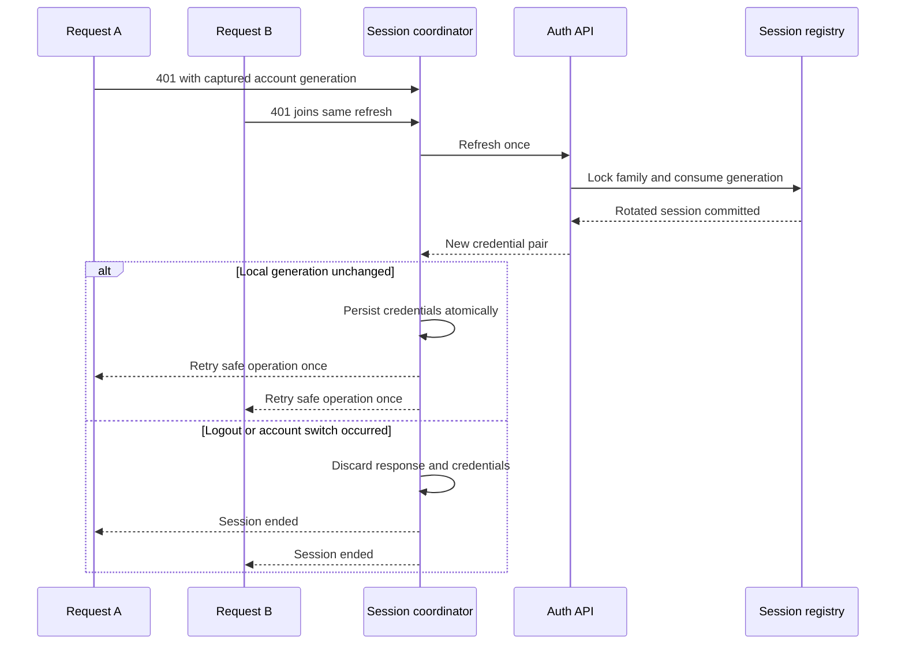
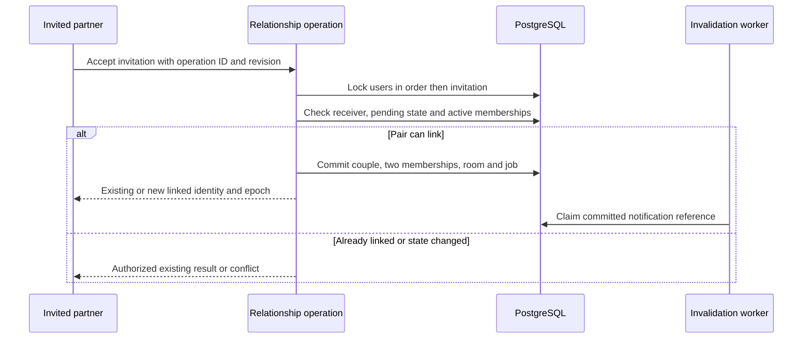
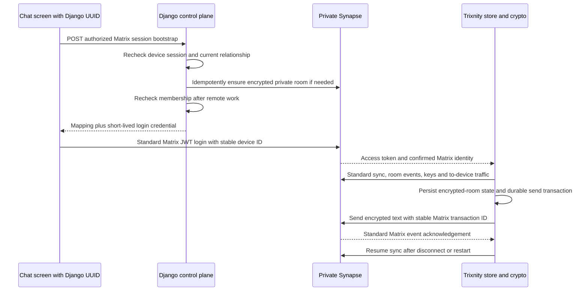
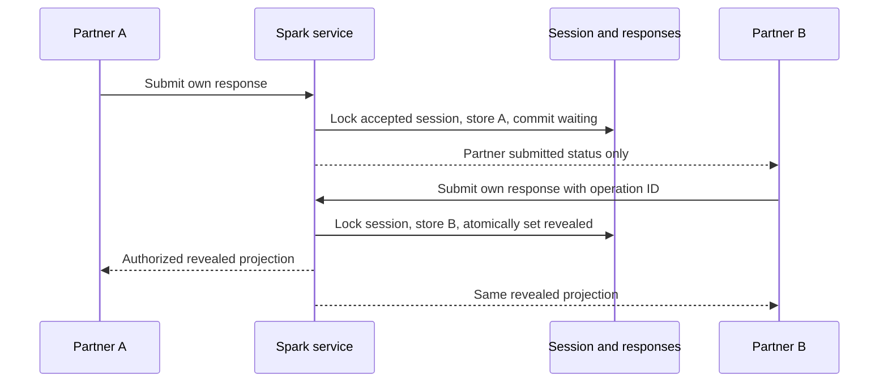
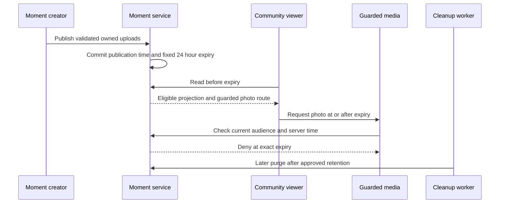

# Contracts and critical sequences

**PROPOSED 0.1.** Existing contracts continue unchanged until their slice is
approved. Except for the observed Matrix bootstrap explicitly identified below,
paths prefixed `/api/v2/`, new fields, events and limits are proposals rather than
claims of available endpoints. Synthetic examples contain no real identities,
tokens or private content.

> **Couple Chat contract override — 2026-10-08:** the accepted message path is
> the standard Matrix client-server API on private Synapse, consumed through
> Trixnity/vodozemac. Django exposes only the authorized Matrix-session bootstrap
> and provisioning/revocation control plane described below. The custom ChatV2
> envelopes, Django message/change/receipt/attachment endpoints and chat socket
> schemas elsewhere in this draft are historical migration evidence, not target
> contracts. See [ADR 003](../decisions/003-matrix-couple-chat.md) and the
> [cutover record](../../flows/couple-chat.md).

## Authority and drift prevention

Design decisions live here in the frontend repository. During implementation,
the **backend repository** becomes the authoritative executable contract location:
`contracts/rest/openapi.yaml`, `contracts/realtime/schema.json`, synthetic
fixtures and `contracts/manifest.json`. The manifest records contract version,
schema digest, backend commit and minimum supported protocol. The frontend pins
an immutable artifact/digest in its own contract manifest; never consume a moving
branch or assume matching branch names mean matching contracts.

The [draft OpenAPI subset](contracts/openapi.proposed.json) and
[realtime draft schema](contracts/realtime.proposed.schema.json) in this design
are reviewable historical specifications for refresh and the retired custom chat
recovery path. They do not describe Matrix, are not a complete description of
today's API, and are not a second production schema registry. Move accepted
non-chat definitions into the backend authority, and pin the Matrix bootstrap
contract separately. Do not generate a Matrix client or new chat transport from
these drafts.

No contract tooling was found to preserve. Use OpenAPI 3.1 for Django HTTP and
JSON Schema 2020-12 where SriSu still owns non-Matrix realtime envelopes. Matrix
events follow the Matrix specification and the pinned SDK; do not duplicate them
in a SriSu AsyncAPI schema. Evaluate DRF schema extraction against Django 6.0.3
and DRF 3.17.1 before choosing its package/version; custom actions, multipart and
permissions still require explicit annotations and tests. Handwritten Kotlin DTOs
remain acceptable for the Django bootstrap when validated against examples and
server response schemas.

Backend CI checks actual responses and socket events against schema fixtures,
detects breaking changes against the released artifact, and publishes immutable
artifacts after approval. Mobile CI decodes the same fixtures, checks its pinned
digest and exercises supported legacy/current shapes. Paired PRs record both
commits, schema digest and Figma node references. A schema file alone does not
prove implementation conformance.

## Current surfaces and migration seams

| Observed current surface | Preserve until compatible replacement exists |
| --- | --- |
| `POST /api/auth/send-otp/`, `POST /api/auth/verify-otp/`, `/api/auth/setup-profile/`, `/api/auth/interests/` | Existing success envelope and `tokens.access`, `tokens.refresh`, `user`; additive server hardening in B1 |
| `/api/social/find-partner/`, `connect-couple/`, `couple-connection/`, `couple-profile/` | Old callers remain supported through a thin adapter to authorized relationship operations; remove broad profile disclosure separately |
| `POST /api/chat/v2/rooms/{uuid}/matrix/session/` | Retain as the authorized Django control-plane boundary; the UUID is the stable `ChatRoom` relationship identity, while the response maps it to a Matrix room and short-lived login credential |
| `/ws/chat/`: `action`, optional `request_id`, `payload`; old numeric message IDs and numeric history cursor | Legacy-only surface. Keep only through the enforced minimum-client cutoff and until non-message relationship hints have a replacement; then retire it. It is never a secure fallback for Matrix |
| `POST /api/chat/media-upload/` | Legacy-only chat media flow. Do not use it for Matrix attachments; retire it after the cutoff and approved destructive purge. Matrix media remains unimplemented in the first release |
| `/api/social/couple-moments/`, `couple-feed/`, `couple-faves/`, `couple-moments/sequence/` | Preserve signed cursor, eligibility, per-user Fave and photo-authorization rules; endpoint-specific decoders because response envelopes differ |

Legacy single-discovery endpoints are outside the intended product. Measure usage,
disable their entry points for new clients, then sunset explicitly; do not delete
their data or routes as part of OTP work.

## Common rules for new contracts

| Concern | Proposed rule |
| --- | --- |
| Identity | Treat IDs as opaque strings in v2. Preserve numeric v1 IDs and database PKs; a mapper converts without rewriting primary keys. Actor/creator comes from authenticated session, never trusted from request fields |
| Time | UTC RFC 3339 with explicit `Z`; server controls publication/expiry. Compare instants, not phone timezone. Responses include `server_time` for display offset, never as permission proof |
| Numbers | Sequence/revision are nonnegative 64-bit integers; Kotlin `Long`; code generators must preserve precision. UUID operation/event IDs are independent of entity IDs |
| Missing/null | Required fields cannot silently default. Explicit `null` means absent value; omitted PATCH field means unchanged. Empty collections are `[]`, not null |
| Enums | Document values; clients retain an `Unknown(raw)` state and do not make an unsafe default transition. Unknown additive fields tolerated. Unknown security/permission states fail closed |
| Versioning | Optional additions can be minor versions; type/removal/meaning changes require a negotiated major version or new field. Server supports released versions until measured adoption and an announced cutoff |
| Errors | Stable code plus safe message, field errors, `request_id`, `retryable`, optional `retry_after_seconds`. UI localizes by code, never parses English strings or displays traceback/provider text |
| Authorization | Bearer required except OTP entry. Return 404 for inaccessible object IDs to reduce existence disclosure; 403 for a known permitted object with disallowed action; 401 for invalid session |
| Updates | Optimistic `expected_revision` for editable resources; mismatch is 409 with authorized current revision. Retry cannot overwrite a partner's later change |
| Idempotency | Stable client UUID per logical mutation. Key includes actor and operation type; request fingerprint includes target/content. Same key + same intent returns stored result; different intent is 409. Reauthorize before returning old result |
| Retry | Safe reads: exponential jitter, honor Retry-After, bounded by foreground deadline. Writes: only replay with durable operation identity and known policy. A timeout can mean committed; reconcile instead of reporting definite failure |

Operation retention is explicit. For Matrix chat, Trixnity's persisted outbox and
Matrix transaction ID own exact-send retry; Django does not retain a parallel
message operation or tombstone. Proposed short-lived invitation/Moment creation
results survive at least seven days; pending mobile retries stop at that horizon
and query canonical state. Refresh is a special non-replayable credential
operation described below. Profile replacement PUT can be idempotent, but
multipart upload attachment is not assumed safe to replay without a stable
operation and upload identity.

| HTTP status / code | Client action / example |
| --- | --- |
| 200/201 | Commit canonical result into matching account/couple/room projection; clear pending state by operation ID |
| 400 `validation_failed` | Keep input; show `fields.phone_number = invalid_format` or `fields.photos = too_many` |
| 401 `session_expired` | Join one coordinated refresh if eligible; replay only authorized safe/idempotent request |
| 403 `creator_required` | Explain current user cannot edit the known Moment; refresh permission state |
| 404 `not_found` | Do not reveal whether an unrelated couple's object exists |
| 409 `revision_conflict`, `operation_key_reused`, `membership_changed` | Reload authorized state; never blind overwrite or reroute action to a new couple |
| 410 `resync_required`, `cursor_expired` | Discard that scoped cursor and reconcile a snapshot; preserve unsent local operations |
| 429 `rate_limited` | Display bounded retry time; do not automatically resend an OTP repeatedly |
| 503 `temporarily_unavailable` | For a mutation, outcome may be unknown; reconcile/retry same operation ID. Provider-specific details stay server-side |

Example error (proposed v2):

```json
{"error":{"code":"revision_conflict","message":"This item changed.","fields":{},"retryable":false,"current_revision":4},"request_id":"req-synthetic-01","server_time":"2026-09-26T10:00:00Z"}
```

## OTP, sessions and onboarding

B1 preserves current OTP endpoint shapes. A later additive challenge ID binds
verification to normalized phone, purpose, request generation and expiry; legacy
clients resolve the latest active challenge through an adapter. Server never
returns an OTP. Successful send means accepted for processing, not delivery.
Resend invalidates previous generations and cannot clear existing verification.
Ambiguous provider failure must not trigger unlimited billable retries.

Proposed `/api/v2/auth/refresh/` accepts the refresh credential and returns access,
rotated refresh, expiries and device session ID. Session registry is checked for
revocation in authenticated REST and realtime work. Use a proposed five-minute
access lifetime, 30-day absolute session limit and explicit device revocation.
These durations need product approval and must not be applied before B2's client.
JWT rotation settings alone do not implement session-family reuse handling.

One SessionCoordinator mutex/shared deferred operation joins concurrent 401s.
Refresh bypasses the normal bearer-refresh interceptor and uses only the trusted
origin. On success, credentials update atomically if captured generation still
matches; old requests cannot revive a logged-out session. Replay a GET or an
idempotent operation once; non-idempotent legacy sends require reconciliation.

Refresh rotates under a device-session row lock. Reuse of an already-consumed
refresh generation revokes its family. **Initial simplicity tradeoff:** if the
server rotated but the response was lost, the client requires reauthentication;
it does not blindly retry the same refresh. This can inconvenience users on poor
networks. A future bounded encrypted replay-response mechanism needs a separate
threat/design decision; do not silently add a reuse grace that aids stolen tokens.



`GET /api/v2/session/` proposes a server-derived projection: identity/profile
status, current couple ID, membership epoch, pending invitation, session expiry
and capabilities. The client maps it to `SignedOut`, `Verifying`,
`ProfileIncomplete`, `AwaitingPartner`, `Linked` or `Unlinked`. A network failure
is an availability overlay, not evidence that the user is signed out or single.
Privileged operations still reauthorize; this projection is not a permission token.

Local logout immediately hides content, invalidates generation and disposes the
session scope. Online `POST /api/v2/auth/logout/` revokes that device family and
closes subscriptions. Offline logout cannot promise server revocation: discard
credentials locally and explain that other devices/server sessions persist until
revocation or expiry. Do not retain the refresh secret merely to queue logout.

## Consent-based linking

Proposed exact-number lookup returns minimal display confirmation and a short-lived
opaque invitation target, never a general searchable directory or full profile.
Normalize phone before lookup, require a verified session, apply global limits
and make repeated probes costly. Existing broad serializer must not define v2.

New invitation operations carry stable operation ID, target reference and expected
revision. Sender comes from session. Crossed invites return the existing pending
pair and expose an explicit accept action; they do not implicitly create consent.
Accept is receiver-only; cancel sender-only; decline receiver-only. Retrying an
accepted invitation returns its existing couple if still authorized. Later
membership change yields conflict, never resurrection of a broken relationship.



Unlink takes the same guards as scoped writes, increments membership epoch,
invalidates current access and creates durable invalidation work. HTTP reads,
commands, subscriptions and each delivery check current authorization. Previously
downloaded bytes cannot be recalled. Historical access after unlink is an explicit
policy decision; default deny until approved, with no automatic transfer to a new
partner. Model migration must preserve original participant identities.

## Matrix bootstrap, send and recovery

The Django `ChatRoom` UUID remains the public relationship-conversation identity
and the `ChatNav.ChatScreen(roomId)` navigation value. It is not a Matrix room ID
and grants no access by itself. The accepted Django boundary is:

```text
POST /api/chat/v2/rooms/{chat_room_uuid}/matrix/session/
Authorization: Bearer <Django access token carrying a current device-session sid>
```

The endpoint has no message body. It rechecks the authenticated device session and
current membership before and after remote provisioning/token work. It returns
`401` for a missing, expired or revoked Django device session; a concealed `404`
for an unknown room, unrelated user or former member; `429` at the scoped bootstrap
throttle; and generic `503 temporarily_unavailable` while provisioning or Synapse
is unavailable. Success uses `Cache-Control: private, no-store`.

Synthetic success shape:

```json
{
  "data": {
    "protocol_id": "matrix-e2ee-v1",
    "homeserver_url": "https://matrix.example.test",
    "room_id": "!opaque:server.name",
    "room_alias": "#srisu_chat_00000000-0000-4000-8000-000000000001_e1:server.name",
    "membership_epoch": 1,
    "relationship_id": 123,
    "self_user_id": 10,
    "self_matrix_user_id": "@srisu_user_10:server.name",
    "partner_user_id": 11,
    "partner_matrix_user_id": "@srisu_user_11:server.name",
    "initiator_user_id": 10,
    "login_type": "org.matrix.login.jwt",
    "login_token": "synthetic-short-lived-jwt",
    "login_token_expires_at": "2026-10-08T12:00:00Z",
    "login_token_one_time": false,
    "refresh_token_enabled": false,
    "access_token_expires_in_seconds": 300
  }
}
```

The login JWT is not a Matrix access token. The current server declares it
replayable during its short validity window (`login_token_one_time=false`; default
maximum 120 seconds), so the UI must not describe it as one-time. It must never
enter navigation, ordinary preferences, logs, analytics, crash reports, screenshots
or fixtures. The client submits it directly to the returned trusted Synapse origin
using `login_type`, a stable relationship-scoped device ID, a display name and
`refresh_token=false`. It rejects a login response whose Matrix user or device
identity does not match the expected account/device. The Matrix access token is
seeded into a volatile Trixnity authentication repository and is not persisted in
Room or ordinary preferences. The declared access-token lifetime must be between
300 and 900 seconds or the client fails closed.



All timelines, pagination, device keys, encrypted room events, transaction retry,
receipts and future encrypted media use standard Matrix APIs directly between
Trixnity and Synapse. Django is not a message proxy and must not store a parallel
message, ciphertext envelope, change cursor, receipt or attachment record. Matrix
`/sync` plus Trixnity's persisted store replace the custom socket-hint + HTTP
snapshot/change protocol. A network timeout leaves the transaction pending until
Trixnity reconciles the same Matrix transaction ID; it never falls back to a new
Django message operation.

The first release supports encrypted text only. The product must not expose reply,
edit, reaction, delete, delivery/read, typing or presence controls until their
Matrix semantics and SriSu policy pass Android↔iOS tests. Photo/video attachments,
voice, Sparks, Ask/polls, rich Planner/story cards, conversation nickname/options,
push and calls are unimplemented and disabled. Unknown Matrix events or content
versions render as an inert/update-required item; they never crash, disclose raw
payloads or grant an action.

An unlink makes Django bootstrap fail immediately and marks the mapped Matrix room
for membership revocation. The UI closes the old scope, cancels presentation of
queued work and stops sync for that relationship; a retry worker completes remote
removal after an outage. Existing downloaded ciphertext cannot be recalled. A
later relationship receives a new Django `ChatRoom`, Matrix room and cryptographic
context—never the former partner's room or keys.

On logout or account switch, call Matrix logout when reachable, then stop sync,
invalidate late completions, clear credentials and apply the approved local-store
wipe policy even if the network call fails. The configured access-token/session
expiry is a recovery bound, not permission to keep another account's store open.
Every foreground restore and deep link reauthorizes the Django UUID before using
the mapped room. Matrix membership alone is never SriSu authorization.

Limits, retry/backpressure, event retention and media quotas must be measured and
configured on Synapse/Trixnity. The text composer uses a conservative 32 KiB UTF-8
plaintext budget so Megolm/base64 and JSON envelopes remain below Matrix's event
ceiling. The retired 64 KiB custom envelope, Django command burst and seven-day
change-cursor proposals are not Matrix limits. Observability
records only redacted bootstrap/sync/error categories, queue age and synthetic
journey timing—never tokens, keys, event bodies or message content.

## Sparks, Challenges and Moments

Sparks propose versioned curated templates with one initial interaction type:
text answer hidden until both accepted participants submit. Each session pins
template version and original members. PUT own response has operation ID and
expected revision; session lock serializes submit/edit/skip/reveal. Before reveal,
the partner's answer is **absent from serialized responses and events**, including
previews and logs. Response availability may be visible; the text is not. New
template edits cannot change an in-progress prompt.



An edit racing reveal either commits before reveal or receives `session_revealed`;
it never silently changes an answer the other partner already saw. Pause/skip
policy is explicit and never reveals incomplete answers. Repeated submission or
completion produces no duplicate side effects. Unlink invalidates the session;
withdrawal and historical visibility remain approval decisions.

Challenge operations are invite/accept/decline, contribution PUT, pause/resume,
cancel and confirm-complete. Both accepted members confirm completion; transaction
locks instance, verifies both confirmations and commits one completed transition.
Template includes duration, together/apart and cost category. Private contributions
do not become Moment fields. Django admin publishes validated template versions
without modifying existing instances. No photo proof, streak penalties or rankings.

Moment publication retains creator-only editing/deletion and <=5 photos. Proposed
staged uploads carry uploader, target couple/epoch, verified type/size and expiry;
finalize locks parent and claims only eligible uploads atomically. Photo ordering
is explicit. Publish assigns immutable server `published_at` and expiry once.
Legacy records retain their original created-at/expiry; adding a new Moment never
renews another. Pending draft/staging is new behavior, not current API capability.



Expiry predicate is `now < expires_at`, including detail, feed hydration, sequence,
notes and photo requests. Worker delay does not extend access. KMP uses server
offset for countdown and hides expired content on resume but never authorizes it.
Prefer current authorized proxy for launch: `private, no-store` and no public
bucket. If direct signed URLs are later accepted, TTL must be at most the remaining
visibility and a short cap; they still cannot promise immediate block/unlink
revocation before expiry. See the privacy decision before choosing that tradeoff.

Discovery retains one card per couple, requester-bound feed order snapshots,
live eligibility and separate Faves. Global uses current configurable locality,
interests, freshness, Faves preference and exploration weights as an initial
heuristic, not a validated recommendation model. Empty Faves stays empty with an
explicit Global action. Low Global content broadens non-sensitive ranking filters
but never permissions or expiry. Seen state is per viewer, time-bounded and opt-out
compatible; hides/blocks suppress before ranking and again on delivery. Preserve
existing 409 preference-change and 410 expired-session cursor behavior.

“Try This Together” accepts an approved template ID and operation ID to create a
private proposal for the viewer's couple. Resolve template availability directly;
an expired source Moment grants no media access. Do not copy responses/photos,
identify the inspired couple publicly, or notify the original creator by default.

## Field traceability through the client

| Backend field / projection | DTO seam | Proposed domain / UI state and rule |
| --- | --- | --- |
| Current `tokens.access`, `tokens.refresh`, `user` | `features/auth/data/remote/response/OtpVerificationResponse.kt` | SessionCoordinator owns credentials; auth state uses identity/profile status. Tokens never enter Compose state or logs |
| New `session_id`, `membership_epoch`, capability projection | New session DTO, not a replacement user model | Session scope and couple scope guard every result; onboarding state is server-derived |
| Django `ChatRoom.id` UUID | Typed navigation argument plus Matrix-bootstrap request | Stable relationship conversation identity only; reauthorize it on every entry and never treat it as Matrix room ID or permission |
| `protocol_id`, `homeserver_url`, `room_id`, `room_alias`, `membership_epoch` and `relationship_id` | New Matrix-bootstrap DTO in the chat control-plane adapter | Validate protocol and trusted origin, bind the Matrix room to the captured account/relationship scope, and reject stale responses |
| `self_user_id`, `self_matrix_user_id`, `partner_user_id`, `partner_matrix_user_id` and `initiator_user_id` | Same bootstrap DTO mapped to typed Django/Matrix identities | Verify the login result and render authors without accepting sender identity from navigation or message content |
| `login_type`, `login_token`, `login_token_expires_at`, `login_token_one_time`, `refresh_token_enabled` and `access_token_expires_in_seconds` | Ephemeral bootstrap credential mapper into the Trixnity login boundary | Never enter Compose state, durable DTO fixtures, logs or analytics; reject expired or contradictory metadata |
| Standard Matrix room events, event IDs and transaction IDs | Trixnity models/repository, not SriSu ChatV2 DTOs | Trixnity store is the sole timeline/outbox authority; unknown content stays inert and a retry reuses the same transaction ID |
| Moment creator, original audience, visibility, immutable times, ordered photos | Proposed feature-specific Moment DTO | Creator action availability and expiry presentation; server still enforces rights |
| Spark own response, partner status, authorized reveal projection | Proposed Spark DTO variants | Waiting UI cannot access a hidden partner answer because it was never transmitted |
| Challenge template version, participant confirmations, revision | Proposed Challenge DTO | Separate per-person progress from joint completion; repeated taps reuse operation ID |

Mapping tests validate required IDs, parse timestamps once and surface malformed
responses as recoverable protocol errors. They must not reinterpret an absent
permission field as granted access. Implementation paths in this table are seams,
not instructions to create every class before the first slice.
