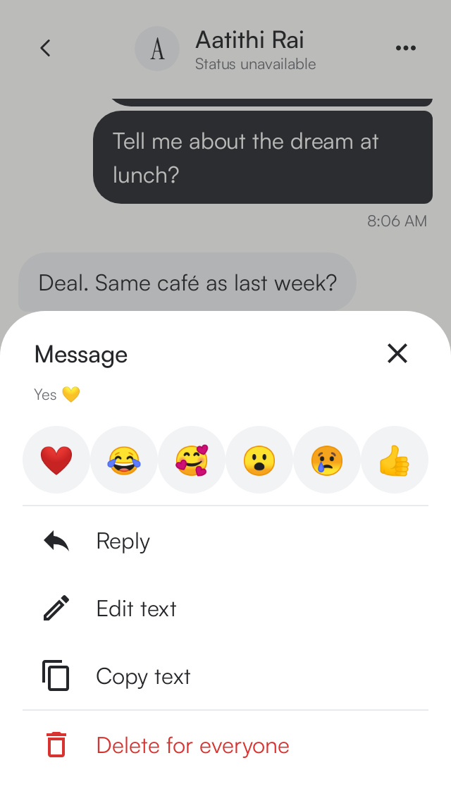
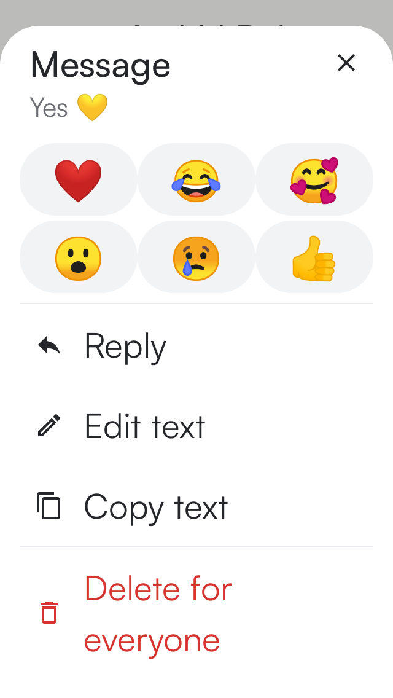
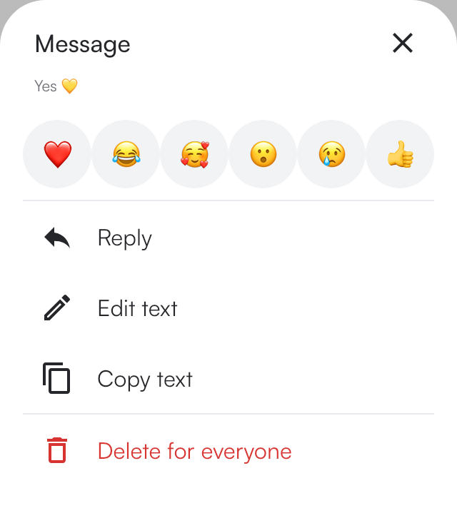
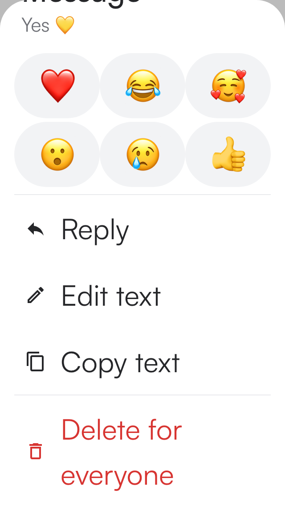
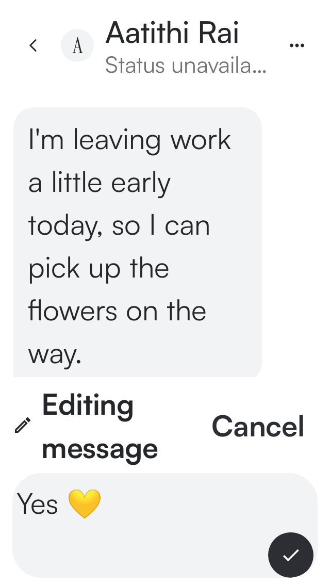

# Chat reliability repair — 19 November 2026

## Source and scope

- Frontend: `SriZan12/SriSu`, same checkout `/Users/srijan/studioprojects/SriSu`, branch `codex/chat-reliability-fixes`, based on `c1f46097503bbe908cae7189fd37c54c6c40ee35`. This base includes the navigation/profile work from PR #30. The user subsequently authorized publishing the combined repairs into `dev-core-architecture`; merging remains outside the task.
- Backend inspected/tested: `SrizanKhadka/SriSu`, existing `codex/couple-chat-rebuild` checkout at `6e0935c1c4f24267b9a956d259db5d113e9bb903`, including its pre-existing local changes. No backend source modification, API, migration or permission change was needed for these chat fixes.
- Live Figma file `LztysD1YvINX7RwZpnhhTt`, Hold to react node `184:28`: inspected successfully, but it contains an empty placeholder. The action sheet derives its appearance from the approved Pure chat tokens/reference; it is not an invented claim of pixel matching a detailed Figma menu. Quick Share and Palette are preserved.
- Hashes of all four pre-existing frontend files and all 39 pre-existing backend files were recorded before work and checked during verification. The user's Home implementation and design documents remain separate from this patch.

## Findings and repair

| Finding | Final behavior |
| --- | --- |
| No implemented message editing path | Own sent plain text edits through an encrypted Matrix replacement. Composer editing keeps the normal draft/reply/media separate, supports Cancel/Back, and keeps failed edits available. Edited messages retain their timeline identity and gain Edited metadata. |
| Child media controls could absorb the parent long press | Photo and voice-control long presses expose the same message menu; movement cancels the hold, and opening the menu consumes release to avoid also opening/playing media. |
| Deletion only acknowledged SDK enqueue | Canonical Matrix redaction waits for server acknowledgement, uses a stable retry transaction, limits UI operations to own sent messages, coalesces duplicate taps, and reports failure. Own undecryptable messages can also be redacted. |
| Deleted media could remain loaded or finish opening late | Redaction evicts previews, dismisses media/playback and rejects stale asynchronous download completions. |
| 6 KiB photo thumbnails were visibly undersized | Native senders generate separate encrypted previews up to 1024 px/256 KiB. Legacy tiny previews can upgrade from encrypted originals. Downloads and in-memory cache are bounded; original upload limits are unchanged. |
| Completed thumbnail jobs permanently blocked retries | Completed jobs leave the in-flight map; retries work after failure/re-entry and after readiness changes. |
| Menu used the surrounding app theme and could overflow | Pure/chat palette typography and colors, aligned 48 dp actions, destructive delete color, balanced reaction rows, scrollable large-text layout and a close action. |

## Verification

- `python3 tools/theme/check_theme.py`: passed; retained all 96 documented swatches and checked contrast/token rules.
- Full Android/common suite: **565 tests, 0 failures, 1 skip**. Includes sender-checked edit aggregation, original redaction, unchanged normal drafts, failed edit retry, thumbnail retry, duplicate delete suppression, stale media downloads and existing chat/lifecycle/receipt/playback tests.
- iOS simulator suite: **424 tests, 0 failures** on the dedicated iPhone 17/iOS 26.5 simulator. Includes native Compose chat renders, photo/voice menu gestures, 320 × 568 layouts and 2× text. This suite is not itself a live installed-app network test.
- Android and iOS compilation succeeded. The full iOS Swift/Compose simulator app built with Xcode's local ad-hoc signing; no signing configuration or security protection in the repository was weakened.
- `python3 tools/workspace.py verify backend`: passed the isolated maintained backend suite, **294 tests, 23 skips**, plus its checks/migration checks. Skips and SQLite limitations remain explicit; these tests do not establish production deployment health.
- `MatrixDeviceIntegrationTest` on the installed Android emulator with a separate loopback Django/Synapse stack: passed real encrypted sends, two-participant edit synchronization, original event identity, rejection of partner edits/deletes, photo/voice encrypted file round trips, preview resolution, synchronized deletion, refusal to reopen deleted media, typing start/stop and unrelated-user bootstrap rejection. No production accounts or messages were used.

- `ChatRepairAppDeviceTest`: passed on the installed Android 15/API 35 emulator (`SriSuNavigationQA`, 1080 × 2340 at 440 dpi). Real software keyboard shown, send/save controls visible, send → long press → inline edit → save → Edited → delete completed. An unrelated draft survived the menu/deletion, and repeated timeline swipes left the composer reachable. Final run: 1 test, no skip, 11.235 seconds.
- Final `MatrixDeviceIntegrationTest`: 1 test, no skip, 2.347 seconds. This is separate from the unit-test suite and used two independent encrypted Matrix clients plus an unrelated account.
- Installed iOS app: verified on `SriSu Couple Chat Evaluation`, iPhone 17/iOS 26.5, against the loopback test services. A fresh synthetic message opened the new menu, edited in the existing composer, accepted typed text, saved with Edited metadata and became a tombstone after deletion. With the software keyboard open, the edit text, Cancel and Save remained visible above it. A multiline draft survived leaving/reopening Chat and an app restart. Larger system text was checked after restart, and touch scrolling worked with Reduce Motion enabled. Simulator text size, Reduce Motion and keyboard-capture preferences were restored afterward.
- Final Gradle build/test invocation and final Xcode app build both passed after the composer-state isolation change. `git diff --check` and the theme audit passed. Pre-existing frontend/backend file hashes remained unchanged.

The Android privacy protection makes operating-system chat screenshots black; render captures below provide visual evidence without weakening that protection. No frame-time or physical-device smoothness benchmark was performed. The iOS test history was short; it does not establish long-history scrolling performance.

### Visual evidence

These are synthetic-content captures from the native Compose render tests, not photographs of a physical device. Android captures include the screen; iOS captures isolate the action sheet.

| Normal text, 320-point width | Larger text, 320-point width |
| --- | --- |
|  |  |
|  |  |

## Compatibility and limits

The existing Matrix service and room power levels are retained. New previews fit the old client's 512 KiB download bound. Text edits use standard encrypted `m.replace`; prior SriSu versions did not hide all replacement events, so the old-client fallback may appear as an additional message until that client is updated. No simultaneous Django deployment is required.

The local backend checkout used for chat verification is older than some frontend Home/notification integrations; its missing date-idea/notification endpoints were observed and are not reported as verified by this chat repair. No unrelated backend work was overwritten to align those features.

Emulator/simulator coverage does not establish physical-device camera/microphone permissions, hardware playback, production push delivery, battery/network performance, or smoothness on every device. The voice transport fixture verifies upload/download/deletion, not microphone capture quality. Message redaction cannot erase exported copies or already delivered plaintext on another device.

The thumbnail quality checks exercised the Android photo encoder and encrypted transport; the matching Swift encoder change compiled successfully but was not exercised through the iOS camera/photo-picker with a physical photo. New previews remain deliberately bounded rather than loading every full-resolution original into the scrolling list.

## Publication handoff

Publication uses `codex/chat-reliability-fixes` from the original project folder, targeting `dev-core-architecture`. The PR intentionally includes the navigation/profile repairs from PR #30 as well as the chat fixes. The unrelated local Home implementation and three Home design documents are excluded and preserved. No backend deployment or database migration is required by these repairs. The PR is left unmerged.

Temporary test containers and credential fixtures were removed after verification; existing external QA database volumes were preserved. The dedicated emulator/simulator and the Colima runtime started for verification were stopped afterward. The PR records CI results for its actual published commit separately from the local/native evidence above.
